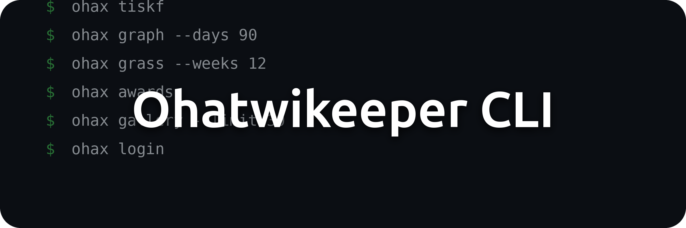

<div align="center">

<p align="center">
  
</p>

<p align="center"><a href="README.md">English</a> | <b>日本語</b></p>

<h1 align="center">Ohatwikeeper CLI</h1>

<h3 align="center">おはツイKeeperの記録を、ターミナルでフルカラー表示。</h3>

<p align="center"><a href="https://ohatwikeeper.com/">おはツイKeeper</a>の公式CLI <code>ohax</code> です。プロフィール、推移グラフ、投稿グラス、アワード、ギャラリーを表示します。Go標準ライブラリのみで、依存パッケージはありません。</p>

<p align="center">
  <a href="https://github.com/ohatwikeeper/ohatwikeeper-cli/releases"></a>
  <a href="https://www.npmjs.com/package/@ohatwikeeper/cli"></a>
  <a href="LICENSE"></a>
  <a href="https://go.dev"></a>
  <a href="https://github.com/ohatwikeeper/ohatwikeeper-cli/stargazers"></a>
  <a href="https://github.com/ohatwikeeper/ohatwikeeper-cli/commits/main"></a>
</p>

<p align="center">
  <a href="#クイックスタート">クイックスタート</a> ·
  <a href="#コマンド">コマンド</a> ·
  <a href="#仕組み">仕組み</a> ·
  <a href="#ライセンス">ライセンス</a>
</p>

</div>

---

`ohax <ユーザー>` を実行すると、プロフィールがターミナルに表示されます。アバターや投稿画像のサムネイルも端末の中に描画し、表示幅は端末に合わせて自動で調整します。truecolor で描画し、256色の端末でも使えます。

## 特長

- **5種類の表示**: プロフィール、推移グラフ（いいね・インプレッション・リポスト・返信）、投稿グラス（日ごとの投稿カレンダー）、アワードと次の目標、画像ギャラリー。`ohax all` で最初の5つをまとめて表示します。
- **端末内のサムネイル**: アバターと投稿画像を、半ブロック文字「▀」で1文字に上下2ピクセルずつ描きます。
- **柔軟なユーザー指定**: `public_uuid` か共有URLを渡せます。URLにページ名があれば、そのページを表示します。
- **Lapountでログイン**: APIキーは不要です。非公開を含む自分の記録を見たり、投稿を追加・削除したりできます。
- **色の制御**: パイプや `NO_COLOR` では自動で色なしになり、オプションや `OHAX_COLOR` で上書きできます。

## クイックスタート

**1. インストール**

npm（Linux / macOS / Windows）:

```sh
pnpm add -g @ohatwikeeper/cli
```

OSとCPUに合ったビルド済みバイナリが入ります。LinuxとmacOSでは、初回の起動時にnodeのシムがネイティブバイナリに置き換わり、以後はnodeを経由しません。更新は同じコマンドで行います。

Goがある場合:

```sh
go install github.com/lapius7/ohatwikeeper-cli/cmd/ohax@latest
```

Goがない場合（Linux / macOS）:

```sh
curl -fsSL https://ohatwikeeper.com/cli/install.sh | bash
```

OSとCPUに合ったビルド済みバイナリを `~/.local/bin/ohax` に置きます（`OHAX_INSTALL_DIR` で変更できます）。Windowsは `https://ohatwikeeper.com/cli/dl/ohax-windows-amd64.exe` を直接ダウンロードしてください。

詳しい使い方: https://ohatwikeeper.com/cli

**2. 試す**

```sh
ohax tiskf
```

## コマンド

```sh
ohax tiskf                 # プロフィール(アバター・統計・連続投稿・直近30日・最近の投稿)
ohax graph tiskf           # 推移グラフ(いいね・インプレッション・リポスト・返信)
ohax grass tiskf           # 投稿グラス(日ごとの投稿カレンダー)
ohax awards tiskf          # アワードと次の目標
ohax gallery tiskf         # 画像ギャラリー(サムネイル付き)
ohax all tiskf             # 上の5つをまとめて表示
ohax rss tiskf             # RSSフィード(XML)
ohax                       # ヘルプ
```

ユーザーには、`public_uuid` のほか共有URLもそのまま渡せます。

```sh
ohax https://tiskf.ohax.pw/graph
ohax ohatwikeeper.com/tiskf/awards
```

<details>
<summary>オプション</summary>

```sh
ohax graph --days 90       # 直近90日だけ
ohax grass --weeks 12      # 直近12週間だけ(既定は画面幅に合わせる)
ohax gallery --limit 30    # 30件(既定12件)
ohax gallery --no-images   # サムネイルなしの一覧
ohax --width 80 awards     # 表示幅を指定
```

</details>

<details>
<summary>ブラウザ</summary>

```sh
ohax open graph            # 推移グラフをブラウザで開く
ohax url awards tiskf      # ブラウザ用URLを表示するだけ
```

</details>

### ログイン（Lapount・推奨）

CLIは Lapount でログインするだけで使えます。APIキーは不要です（APIキーはブラウザ拡張で使います）。

```sh
ohax login                 # ブラウザでLapountを承認
ohax whoami                # ログイン中のアカウント
ohax list                  # 自分の記録(非公開を含む)
ohax add <ツイートURL>...  # おはツイを登録
ohax rm <ID|ツイートURL>... # おはツイを削除
ohax profile               # ログイン後はユーザー省略でOK
ohax logout
```

> [!IMPORTANT]
> 事前にXでログインし、設定からLapountを連携しておく必要があります（新規登録はXのみ）。`ohax use` は廃止されました。

ログイン情報の保存先は `$XDG_CONFIG_HOME/ohax/config.json` です（macOSは `~/Library/Application Support/ohax/`、Windowsは `%AppData%\ohax\`）。

## 設定

出力先が端末なら色付き、パイプ・リダイレクト先や `NO_COLOR` 設定時は自動で色なしになります（サムネイルも出さず、画像はURLで表示）。`-n` / `--no-color` で強制的に色なし、`--color` でパイプ先でも色付きにできます。色の段階は `COLORTERM` などから判定し、`OHAX_COLOR=truecolor|256|none` で上書きできます。

そのほかの環境変数: `OHAX_UUID` で既定ユーザーを上書きし、`OHAX_BASE_URL` で接続先を差し替えます（開発用）。

## 仕組み

- データはおはツイKeeperの公開API（`https://ohatwikeeper.com/api/v2/public/users/<uuid>/...`）から取ります。画面はすべてこのCLIで描画しており、サーバーの `curl` 向けテキストカードは使っていません。
- サムネイルは pbs.twimg.com の小さいJPEGを取得し、「▀」1文字に上下2ピクセルずつ描きます。ギャラリーの「画像を開く」リンクは、公開APIが返す `image_proxy_url`（img.ohatwikeeper.com）です。

> [!NOTE]
> この README は既存の文面を書き直し、ソース（コマンド、オプション、環境変数）と照合しました。書き直しにあたって、コマンドの実行はしていません。

## 開発

`build.sh` で全OS/CPU向けにクロスコンパイルし、ohatwikeeper.com の `cli/dl/`（と `cli/install.sh`）に配置します。`OHAX_DIST_DIR=dist ./build.sh` なら手元に出すだけです。このスクリプトはこのリポジトリにはありません。

`v*` タグを push すると GitHub Actions（`.github/workflows/release.yml`）が `npm/build.mjs` でビルドして npm に公開し、GitHub Release にもバイナリを添付します。認証は npm の Trusted Publisher なのでトークンは不要です。手元での確認は `node npm/build.mjs 0.0.0-dev --pack` です。

## ライセンス

オープンソースではありません。公式の配布物は無償で使えますが、ソースの改変や再配布はできません。詳細は [LICENSE](./LICENSE) を参照してください。
