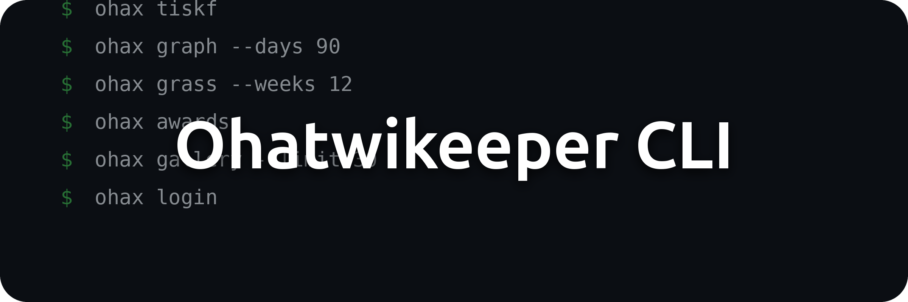

<div align="center">

<p align="center">
  
</p>

<p align="center"><b>English</b> | <a href="README.ja.md">日本語</a></p>

<h1 align="center">Ohatwikeeper CLI</h1>

<h3 align="center">See your Ohatwikeeper records in full color, right in the terminal.</h3>

<p align="center">The official <code>ohax</code> command for <a href="https://ohatwikeeper.com/">おはツイKeeper</a>. It shows profiles, trend graphs, post grass, awards, and galleries. Go standard library only, no dependencies.</p>

<p align="center">
  <a href="https://github.com/ohatwikeeper/ohatwikeeper-cli/releases"></a>
  <a href="https://www.npmjs.com/package/@ohatwikeeper/cli"></a>
  <a href="LICENSE"></a>
  <a href="https://go.dev"></a>
  <a href="https://github.com/ohatwikeeper/ohatwikeeper-cli/stargazers"></a>
  <a href="https://github.com/ohatwikeeper/ohatwikeeper-cli/commits/main"></a>
</p>

<p align="center">
  <a href="#quick-start">Quick start</a> ·
  <a href="#commands">Commands</a> ·
  <a href="#how-it-works">How it works</a> ·
  <a href="#license">License</a>
</p>

</div>

---

Run `ohax <user>` and the profile appears in the terminal, with the avatar and post thumbnails drawn as terminal graphics. The width follows your terminal. Output uses truecolor and also works on 256-color terminals.

## Features

- **Five views**: profile, trend graph (likes, impressions, reposts, replies), post grass (daily calendar), awards with the next goal, and an image gallery. `ohax all` shows the first five together.
- **Thumbnails in the terminal**: avatars and post images are drawn with the half-block character `▀`, two pixels per cell.
- **Flexible user input**: pass a `public_uuid` or a share URL. If the URL contains a page name, that page is shown.
- **Login with Lapount**: no API key needed. You can see your own records, including private ones, and add or remove posts.
- **Color control**: automatic color off for pipes and `NO_COLOR`; override with flags or `OHAX_COLOR`.

## Quick start

**1. Install**

With npm (Linux / macOS / Windows):

```sh
pnpm add -g @ohatwikeeper/cli
```

A prebuilt binary for your OS and CPU is installed. On Linux and macOS, the first run replaces the node shim with the native binary. Run the same command to update.

With Go:

```sh
go install github.com/lapius7/ohatwikeeper-cli/cmd/ohax@latest
```

Without Go (Linux / macOS):

```sh
curl -fsSL https://ohatwikeeper.com/cli/install.sh | bash
```

This puts a prebuilt binary at `~/.local/bin/ohax` (change it with `OHAX_INSTALL_DIR`). On Windows, download `https://ohatwikeeper.com/cli/dl/ohax-windows-amd64.exe` directly.

More details: https://ohatwikeeper.com/cli

**2. Try it**

```sh
ohax tiskf
```

## Commands

```sh
ohax tiskf                 # profile (avatar, stats, streak, last 30 days, recent posts)
ohax graph tiskf           # trend graph (likes, impressions, reposts, replies)
ohax grass tiskf           # post grass (daily calendar)
ohax awards tiskf          # awards and the next goal
ohax gallery tiskf         # image gallery with thumbnails
ohax all tiskf             # the five views above
ohax rss tiskf             # RSS feed (XML)
ohax                       # help
```

A user can be a `public_uuid` or a share URL:

```sh
ohax https://tiskf.ohax.pw/graph
ohax ohatwikeeper.com/tiskf/awards
```

<details>
<summary>Options</summary>

```sh
ohax graph --days 90       # last 90 days only
ohax grass --weeks 12      # last 12 weeks only (default fits the screen width)
ohax gallery --limit 30    # 30 items (default 12)
ohax gallery --no-images   # list without thumbnails
ohax --width 80 awards     # set the display width
```

</details>

<details>
<summary>Browser</summary>

```sh
ohax open graph            # open the trend graph in the browser
ohax url awards tiskf      # only print the URL for the browser
```

</details>

### Log in (Lapount, recommended)

The CLI needs only a Lapount login. No API key is required (API keys are for the browser extension).

```sh
ohax login                 # approve Lapount in the browser
ohax whoami                # the logged-in account
ohax list                  # your own records, including private ones
ohax add <tweet URL>...    # register a post
ohax rm <ID|tweet URL>...  # delete a post
ohax profile               # after login, the user can be omitted
ohax logout
```

> [!IMPORTANT]
> Log in to X beforehand and link Lapount in the settings (new sign-up is X only). `ohax use` has been removed.

The login is saved in `$XDG_CONFIG_HOME/ohax/config.json` (macOS: `~/Library/Application Support/ohax/`, Windows: `%AppData%\ohax\`).

## Configuration

Color output is on for a terminal and off for pipes, redirects, and when `NO_COLOR` is set (no thumbnails either; images are shown as URLs). `-n` / `--no-color` forces plain output and `--color` forces color even when piped. The color depth is detected from `COLORTERM` and similar; override it with `OHAX_COLOR=truecolor|256|none`.

Other environment variables: `OHAX_UUID` overrides the default user, and `OHAX_BASE_URL` changes the API origin (for development).

## How it works

- Data comes from the public Ohatwikeeper API (`https://ohatwikeeper.com/api/v2/public/users/<uuid>/...`). Every screen is drawn by this CLI; the server's text cards for `curl` are not used.
- Thumbnails are small JPEGs from pbs.twimg.com, drawn with `▀` at two pixels per cell. The gallery's "open image" link is the `image_proxy_url` (img.ohatwikeeper.com) returned by the public API.

> [!NOTE]
> This README was rewritten from the existing text and checked against the source (commands, flags, environment variables). The commands were not run for this rewrite.

## Development

`build.sh` cross-compiles for every OS and CPU and places the files in `cli/dl/` (and `cli/install.sh`) of ohatwikeeper.com. `OHAX_DIST_DIR=dist ./build.sh` only writes them locally. The script is not in this repository.

Pushing a `v*` tag runs GitHub Actions (`.github/workflows/release.yml`). It builds with `npm/build.mjs`, publishes to npm, and attaches the binaries to the GitHub Release. npm Trusted Publisher handles authentication, so no token is needed. To check locally: `node npm/build.mjs 0.0.0-dev --pack`.

## License

Not open source. The official builds are free to use, but you may not modify or redistribute the source. See [LICENSE](./LICENSE).
